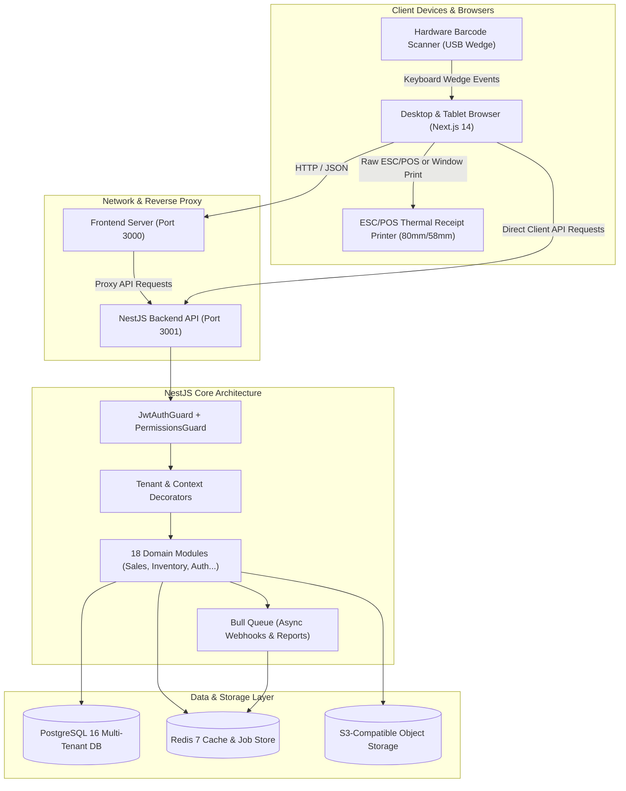
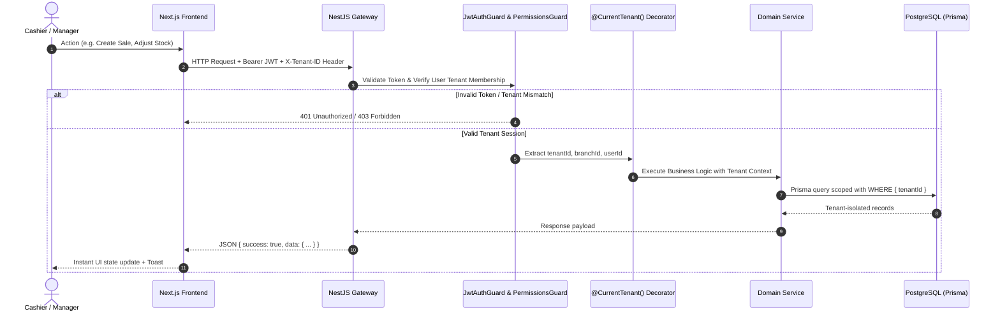
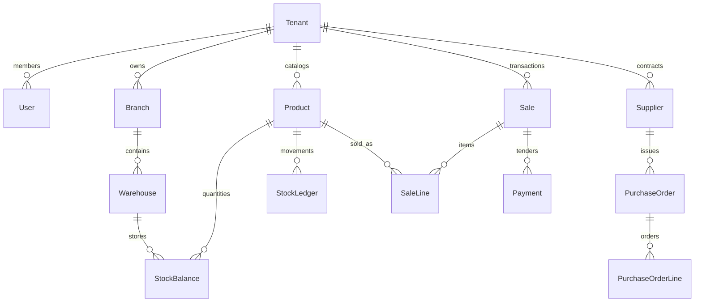

# 🏛️ Inventory_SaaS: Master System Architecture & Developer Handbook

> **Target Audience:** Software Engineers, System Architects, and AI Coding Agents  
> **Repository:** `nihal8547/Inventory_SaaS`  
> **Workspace Root:** `c:\Users\Nihal\Documents\Webbea\Website\Inventory_SaaS`  
> **Last Verified:** October 26, 2026  
> **Status:** Production-Ready, Fully Typed, Multi-Tenant Architecture

---

## 📑 Table of Contents
1. [Executive Summary & Domain Overview](#1-executive-summary--domain-overview)
2. [Complete Technology Stack](#2-complete-technology-stack)
3. [System Architecture & Visual Diagrams](#3-system-architecture--visual-diagrams)
4. [Multi-Tenant Data Isolation Strategy](#4-multi-tenant-data-isolation-strategy)
5. [Backend API Modules Directory (All 18 Modules)](#5-backend-api-modules-directory)
6. [Frontend Application Architecture & Route Registry](#6-frontend-application-architecture--route-registry)
7. [Hardware Integrations & POS Operations](#7-hardware-integrations--pos-operations)
8. [Database Domain Models & Relations (Prisma)](#8-database-domain-models--relations-prisma)
9. [Security, Authentication & RBAC Enforcement](#9-security-authentication--rbac-enforcement)
10. [Developer & AI Contribution Rules (Do's & Don'ts)](#10-developer--ai-contribution-rules)

---

## 1. Executive Summary & Domain Overview

**Inventory_SaaS** is an enterprise-grade, multi-tenant cloud inventory, Point-of-Sale (POS), and supply chain management platform designed primarily for retail, wholesale, and multi-branch physical stores (optimized for MENA/GCC markets with QAR currency, tax handling, and bilingual support).

### Key Business Domains
* **Strict Multi-Tenancy**: Every business operation is isolated by `tenantId`. A single database serves thousands of tenants without data leakage.
* **Point of Sale (POS)**: Ultra-fast barcode-driven checkout terminal, multi-tender transactions (Cash, Card, QR), split bills, shift registers, and thermal ESC/POS receipt generation (80mm/58mm).
* **Inventory & Multi-Warehouse Tracking**: Double-entry style stock ledger (immutable balance movements), cross-warehouse transfers with approval stages, and physical stock count variance reconciliation.
* **Purchasing & Goods Receipt**: Complete purchase order lifecycle, vendor credit management, and variance tracking during item receiving.
* **Extensibility**: Outbound Webhook dispatching with HMAC SHA-256 signatures and scoped third-party API Keys.

---

## 2. Complete Technology Stack

### Frontend Application (`/frontend`)
| Layer | Technology | Version | Purpose |
|---|---|---|---|
| **Framework** | Next.js (App Router) | `14.2.5` | SSR, Static optimization, Route grouping, Server Components |
| **Language** | TypeScript | `^5.6.0` | Strict static typing across all UI interfaces |
| **Styling** | Tailwind CSS + Animate | `^3.4.14` | Utility-first responsive design, modern dark/light themes |
| **UI Primitives** | Radix UI | Latest | Accessible Dialogs, Dropdowns, Popovers, Tabs, Tooltips |
| **Icons** | Lucide React | `^0.454.0` | High-fidelity UI iconography |
| **State Management** | Zustand | `^5.0.1` | Lightweight client stores (Auth, Cart, Active Branch, Devices) |
| **Data Tables** | TanStack Table | `^8.20.5` | Headless pagination, sorting, search, column defs |
| **Charts** | Recharts | `^2.13.0` | Dashboard KPIs, revenue graphs, and sales breakdowns |
| **Hardware / Barcodes** | JsBarcode + QRCode | `^3.11.6` | Canvas and SVG barcode & QR rendering |
| **Excel Export** | SheetJS (xlsx) | `^0.18.5` | Client-side spreadsheet generation & data exporting |
| **Notifications** | Sonner | `^1.5.0` | Toast notifications with action hooks |

### Backend Service (`/backend`)
| Layer | Technology | Version | Purpose |
|---|---|---|---|
| **Framework** | NestJS | `^10.4.5` | Modular enterprise Node.js micro-framework |
| **Language** | TypeScript | `^5.6.0` | Strict decorators, DTO validation, and service contracts |
| **ORM** | Prisma ORM | `^5.22.0` | Schema migrations, type-safe SQL query generation |
| **Database** | PostgreSQL | `16-alpine` | Relational multi-tenant storage with row-level indexing |
| **In-Memory Cache** | Redis 7 + Bull Queue | `^4.16.3` | Session management, async tasks, throttler & webhook jobs |
| **Security** | Passport JWT + BCrypt | `^10.0.3` | Dual token authentication (AccessToken + RefreshToken) |
| **API Docs** | Swagger / OpenAPI | `^7.4.2` | Interactive REST documentation at `/api/docs` |

---

## 3. System Architecture & Visual Diagrams

### High-Level System Architecture


### Request Lifecycle & Multi-Tenant Guard Execution


---

## 4. Multi-Tenant Data Isolation Strategy

Data isolation in this repository follows the **Shared Database, Shared Schema with Tenant ID Scoping** pattern:

1. **Foreign Key Binding**: Almost every domain model in `schema.prisma` includes:
   ```prisma
   tenantId    String   @db.Uuid
   tenant      Tenant   @relation(fields: [tenantId], references: [id], onDelete: Cascade)
   @@index([tenantId])
   ```
2. **Guaranteed Scoping in Services**: Controllers use `@CurrentTenant() tenantId: string` and pass it directly to service methods.
3. **Double Verification**: Even when querying by a primary ID (e.g., `updateProduct(tenantId, id, data)`), queries MUST enforce:
   ```typescript
   await this.prisma.product.findFirst({
     where: { id, tenantId } // NEVER query by id alone!
   });
   ```

---

## 5. Backend API Modules Directory

Located in `backend/src/modules/`:

| # | Module | Base Route | Core Capabilities |
|---|---|---|---|
| **1** | **`auth`** | `/api/v1/auth` | JWT issuance, Refresh token rotation, Password reset, Session invalidation |
| **2** | **`tenants`** | `/api/v1/tenants` | Tenant profile, business settings, timezone, currency, branding colors |
| **3** | **`users`** | `/api/v1/users` | Employee directory, staff branch assignments, membership bindings |
| **4** | **`roles`** | `/api/v1/roles` | RBAC roles, permission matrix mapping (`SYSTEM_PERMISSIONS`) |
| **5** | **`branches`** | `/api/v1/branches` | Store locations, retail branches, warehouse depots, tax rates |
| **6** | **`products`** | `/api/v1/products` | Master SKUs, variants, categories, brands, units, stock alerts |
| **7** | **`barcodes`** | `/api/v1/barcodes` | EAN-13, Code-128, QR generation, batch label templates |
| **8** | **`inventory`** | `/api/v1/inventory` | Stock balances, stock ledger movements, stock transfers, stock counts |
| **9** | **`purchasing`**| `/api/v1/purchasing`| Suppliers, Purchase Orders (PO), Goods Receiving (`/orders/:id/receive`) |
| **10**| **`sales`** | `/api/v1/sales` | POS transactions, quotes, returns, cashier shifts, daily/monthly registers |
| **11**| **`reports`** | `/api/v1/reports` | Executive dashboard analytics, profit & loss, stock valuation |
| **12**| **`finance`** | `/api/v1/finance` | Operational store expenses, categories, daily financial summaries |
| **13**| **`notifications`**| `/api/v1/notifications`| Internal operational notifications, unread badges, mark-as-read |
| **14**| **`mail`** | `/api/v1/mail` | Automated transactional emails (Invoices, PO copies, Shift summaries) |
| **15**| **`integrations`**| `/api/v1/integrations`| Third-party API Client credentials and permission-scoped keys |
| **16**| **`webhooks`** | `/api/v1/webhooks` | Outbound event subscriptions, HMAC delivery dispatch, retry logs |
| **17**| **`admin`** | `/api/v1/admin` | Super-Admin platform metrics, global tenant suspension/activation |
| **18**| **`health`** | `/api/v1/health` | Service liveness, readiness, PostgreSQL and Redis latency checks |

---

## 6. Frontend Application Architecture & Route Registry

Located in `frontend/src/app/`:

### Authentication & Public Routes
* `/(auth)/login/page.tsx`: Standard cashier / manager login with tenant selector.
* `/(auth)/login/admin/page.tsx`: Dedicated platform Super-Admin authentication portal.
* `/(auth)/register/page.tsx`: Self-service tenant signup and initial store creation.

### Protected Dashboard Routes (`/(dashboard)/`)
* **`dashboard/`**: Real-time sales charts, revenue statistics, top products, low stock alerts.
* **`pos/`**: Touch and keyboard optimized POS checkout terminal:
  - Rapid barcode scan input buffer.
  - Cart state with line-item discounts, custom taxes, and item search.
  - Multi-tender modal (Cash, Card, Store Credit, Split payments).
  - Web Audio acoustic feedback on scan, item add, and sale success.
* **`pos/today/`**: Real-time daily register, cashier shift reconciliation, and hourly sales trends.
* **`products/`**: Master catalog table with advanced filters, category/brand drilldown, Excel export.
* **`products/new/` & `products/[id]/`**: Product creator and editor with variant configuration.
* **`products/barcodes/` & `barcodes/labels/`**: Batch barcode printing designer (A4, 50x25mm thermal labels).
* **`inventory/stock/`**: Real-time stock-on-hand across branches and warehouses.
* **`inventory/transfers/`**: Inter-warehouse stock transfers (Draft -> In-Transit -> Received).
* **`inventory/stock-counts/`**: Physical stock counting sessions and variance reconciliations.
* **`inventory/receiving/`**: Warehouse receiving portal against Purchase Orders.
* **`purchasing/orders/`**: Complete PO workflow (Draft -> Approved -> Partially Received -> Completed).
* **`purchasing/suppliers/`**: Vendor address book, credit limit settings, payment terms.
* **`sales/`**: Complete sales invoice registry with receipt re-printing and order voiding.
* **`finance/`**: Store expenses tracker, category breakdowns, daily cash out records.
* **`reports/`**: In-depth analytics, profit & loss, dead stock, and employee performance.
* **`users/`**: Staff account administration, roles assignment, and branch allocations.
* **`branches/`**: Multi-branch and warehouse setup.
* **`settings/`**: Store profile, invoice styling, tax rates, currency format.
* **`settings/barcode-scanners/`**: Hardware scanner diagnostics and keystroke delay testing.
* **`integrations/`**: Webhook endpoint registry, API keys generation with granular scopes.
* **`admin/tenants/`**: Super-Admin multi-tenant management portal.
* **`offline/`**: PWA offline fallback screen when internet connectivity drops.

---

## 7. Hardware Integrations & POS Operations

### 1. Barcode Scanner Support
* Handled via `frontend/src/hooks/use-barcode-scanner.ts`.
* Operates by listening to fast sequential `keydown` events (typically `< 50ms` between characters) terminated by an `Enter` key.
* Diagnostic tool available at `/settings/barcode-scanners` to test hardware wedge performance.

### 2. Thermal Receipt Printing (ESC/POS)
* Handled via `frontend/src/lib/hardware-printer.ts`.
* Supports standard 80mm and 58mm thermal receipts.
* Provides dual modes:
  1. Direct `@media print` CSS engine with 0-margin clipping.
  2. WebUSB / WebBluetooth raw ESC/POS byte streaming for compatible receipt printers.

### 3. Acoustic Feedback Engine
* Handled via `frontend/src/lib/audio-feedback.ts`.
* Generates synthetic frequency tones using the Web Audio API (`AudioContext`) without loading external audio assets:
  - `beepSuccess()`: High-pitch chirp on barcode scan.
  - `beepError()`: Low double-buzz on invalid SKU or out-of-stock.
  - `beepComplete()`: Ascending musical chime on completed transaction.

---

## 8. Database Domain Models & Relations (Prisma)

### Primary Domain Model Schema Map


### Immutable Stock Ledger Principle
Stock quantities are **never** mutated arbitrarily. Any change to physical inventory MUST write an entry to `StockLedger`:
* `movementType`: `SALE`, `PURCHASE`, `TRANSFER_IN`, `TRANSFER_OUT`, `ADJUSTMENT_ADD`, `ADJUSTMENT_SUB`
* `quantity`: Positive or negative delta
* `balanceBefore` & `balanceAfter`: Auditable balance snapshots

---

## 9. Security, Authentication & RBAC Enforcement

1. **Authentication**:
   * Access Token: Short-lived JWT (`7d` default, configurable via `JWT_EXPIRY`).
   * Refresh Token: Long-lived token (`30d`) stored hashed in `UserSession` table.
2. **Role-Based Access Control (RBAC)**:
   * Guarded via `@RequirePermissions('products.create', ...)` on controllers.
   * Super Admins (`user.isSuperAdmin === true`) bypass tenant-specific role restrictions.
3. **CORS & Headers**:
   * Protected with `Helmet` middleware.
   * NestJS Throttler protects public endpoints against brute force (`THROTTLE_LIMIT=100`, `THROTTLE_TTL=60`).

---

## 10. Developer & AI Contribution Rules

> [!CAUTION]
> **CRITICAL INSTRUCTIONS FOR FUTURE AI AGENTS & DEVELOPERS:**

1. **NEVER OVERWRITE OR REPLACE THE FULL REPOSITORY**:
   * Do NOT switch to older orphan commits or re-initialize Git. The working branch is `claude/admiring-meitner-joyl7k`.
2. **MAINTAIN TENANT ISOLATION**:
   * Every database read, update, or delete MUST include `where: { tenantId }`.
3. **PRESERVE ALL ROUTE IMPLEMENTATIONS**:
   * Do not simplify complex pages (such as `/pos`, `/inventory/receiving`, `/admin/tenants`) into minimal skeletons. Every page in this repository has production-level features.
4. **TYPE SAFETY IS MANDATORY**:
   * Before committing, always run:
     - `npm run type-check` (in `/frontend`)
     - `npx tsc --noEmit` (in `/backend`)
   * Code with TypeScript errors must not be deployed.
5. **PORT STANDARDS**:
   * `3000`: Next.js Frontend
   * `3001`: NestJS Backend API
   * `5432`: PostgreSQL
   * `6379`: Redis
