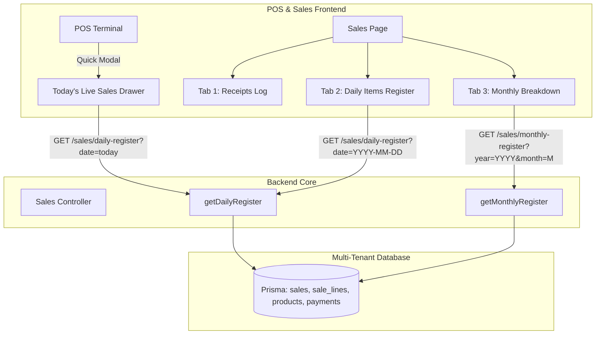

# Implementation Plan: POS Daily & Monthly Sales Register with Item Breakdown

## Executive Summary (ലഘുവിവരണം)
നിങ്ങൾ ആവശ്യപ്പെട്ടതുപോലെ, **Point of Sale (POS)**-ലും **Sales Orders** സെക്ഷനിലും ദിവസേനയും മാസേനയും നടക്കുന്ന വിൽപ്പനകൾ, ഓരോ ദിവസവും വിറ്റ സാധനങ്ങൾ (**Items Sold**), അവയുടെ എണ്ണം (**Items Count / Quantities**), പേയ്മെന്റ് രീതികൾ, കാഷ്യർ വിവരങ്ങൾ എന്നിവ കൃത്യമായി കാണാനുള്ള **Daily & Monthly Sales Register** സംവിധാനത്തിനായുള്ള സമ്പൂർണ്ണ ഇംപ്ലിമെന്റേഷൻ പ്ലാൻ താഴെ നൽകുന്നു.

ഈ സംവിധാനം വഴി:
1. **POS Terminal-ൽ നിന്ന് തന്നെ:** കാഷ്യർക്ക് / മാനേജർക്ക് അന്നത്തെ ദിവസം ഇതുവരെ വിറ്റ സാധനങ്ങളും, എണ്ണവും, കളക്ഷനും തത്സമയം പരിശോധിക്കാം.
2. **Daily Sales Register (പ്രതിദിന രജിസ്റ്റർ):** ഏത് ദിവസത്തെയും തെരഞ്ഞെടുത്ത്, അന്നത്തെ ആകെ വരുമാനം, ബില്ലുകളുടെ എണ്ണം, വിറ്റ ഓരോ ഐറ്റത്തിന്റെയും പേര്, SKU, വിറ്റ എണ്ണം (Quantity), ലഭിച്ച തുക, പേയ്മെന്റ് വിഭജനം (Cash, Card) എന്നിവ പരിശോധിക്കാം.
3. **Monthly Sales Register (പ്രതിമാസ രജിസ്റ്റർ):** മാസത്തിലെ ആകെ വരുമാനം, ആകെ വിറ്റ ഐറ്റങ്ങളുടെ എണ്ണം, മാസത്തിലെ ഓരോ ദിവസവും (Day 1 to 31) നടന്ന വരുമാനവും വിറ്റ ഐറ്റങ്ങളുടെ എണ്ണവും പട്ടികയായും കാണാം. കൂടാതെ ആ മാസത്തിൽ ഏറ്റവും കൂടുതൽ വിറ്റ ഐറ്റങ്ങളുടെ റാങ്കിംഗും ലഭ്യമാകും.

---

## 1. System Architecture & Requirements Breakdown



---

## 2. API Specifications (Backend Endpoints)

### A. Daily Sales & Items Register Endpoint
- **Route:** `GET /sales/daily-register`
- **Query Params:**
  - `date`: `string` (Format: `YYYY-MM-DD`, default: current date in tenant timezone)
  - `branchId`: `string` (Optional: `'all'` or specific branch UUID)
  - `cashierId`: `string` (Optional: filter by specific cashier)
- **Response Structure:**
  ```json
  {
    "success": true,
    "data": {
      "date": "2026-10-25",
      "branchId": "all",
      "summary": {
        "grossRevenue": 14590.00,
        "subtotal": 13900.00,
        "tax": 690.00,
        "discount": 0.00,
        "invoicesCount": 38,
        "totalItemsSold": 94,
        "avgOrderValue": 383.95
      },
      "payments": [
        { "method": "CASH", "amount": 6200.00, "count": 22 },
        { "method": "CARD", "amount": 8390.00, "count": 16 }
      ],
      "itemsSold": [
        {
          "productId": "prod-uuid-1",
          "productName": "Apple iPad Pro 11 M4 256GB",
          "sku": "IPAD-PRO-M4",
          "category": "Electronics",
          "quantitySold": 3,
          "unitPrice": 3999.00,
          "totalRevenue": 11997.00,
          "contributionPercent": 82.2
        },
        {
          "productId": "prod-uuid-2",
          "productName": "Logitech MX Master 3S Mouse",
          "sku": "LOGI-MX3S",
          "category": "Accessories",
          "quantitySold": 5,
          "unitPrice": 399.00,
          "totalRevenue": 1995.00,
          "contributionPercent": 13.7
        }
      ],
      "hourlyBreakdown": [
        { "hour": "09:00 - 10:00", "orders": 4, "items": 8, "revenue": 1200.00 },
        { "hour": "10:00 - 11:00", "orders": 7, "items": 15, "revenue": 3400.00 }
      ],
      "transactions": [
        {
          "saleNumber": "REC-2026-00042",
          "time": "14:22",
          "cashier": "Ahmed Ali",
          "customer": "Walk-in Customer",
          "itemsCount": 2,
          "total": 4398.00,
          "paymentMethod": "CARD"
        }
      ]
    }
  }
  ```

---

### B. Monthly Sales & Day-by-Day Breakdown Endpoint
- **Route:** `GET /sales/monthly-register`
- **Query Params:**
  - `year`: `number` (e.g. `2026`)
  - `month`: `number` (1 to 12)
  - `branchId`: `string` (Optional)
- **Response Structure:**
  ```json
  {
    "success": true,
    "data": {
      "year": 2026,
      "month": 10,
      "monthName": "October 2026",
      "summary": {
        "totalRevenue": 248920.00,
        "totalInvoices": 684,
        "totalItemsSold": 1540,
        "avgDailyRevenue": 9956.80,
        "peakDay": { "date": "2026-10-18", "revenue": 24500.00 },
        "lowestDay": { "date": "2026-10-04", "revenue": 3200.00 }
      },
      "dailyBreakdown": [
        {
          "date": "2026-10-01",
          "dayOfWeek": "Thu",
          "invoicesCount": 28,
          "itemsSold": 64,
          "revenue": 10250.00,
          "topItem": "Apple iPad Pro"
        },
        {
          "date": "2026-10-02",
          "dayOfWeek": "Fri",
          "invoicesCount": 35,
          "itemsSold": 82,
          "revenue": 14800.00,
          "topItem": "Samsung Galaxy S24"
        }
      ],
      "monthlyTopItems": [
        {
          "productId": "prod-1",
          "name": "Apple iPad Pro 11 M4",
          "sku": "IPAD-PRO-M4",
          "category": "Electronics",
          "quantitySold": 42,
          "totalRevenue": 167958.00
        }
      ]
    }
  }
  ```

---

## 3. Frontend UX & UI Design

### 1. In POS Terminal Screen (`/pos`):
- **"Today's Sales" Quick Access Button:**
  - POS ഹെഡറിൽ ഒരു `Receipt` ഐക്കണോടുകൂടിയ **"Today's Sales"** ബട്ടൺ നൽകുന്നു.
  - ക്ലിക്ക് ചെയ്യുമ്പോൾ സ്ക്രീൻ വിട്ടുപോകാതെ ഒരു സൈഡ് ഡ്രോയർ (Side Drawer) അല്ലെങ്കിൽ മോഡൽ ഓപ്പൺ ആകും.
  - അന്നത്തെ ഷിഫ്റ്റിലെ:
    - **ആകെ ബില്ലുകൾ (Total Bills)**
    - **ആകെ വിറ്റ സാധനങ്ങളുടെ എണ്ണം (Items Sold Count)**
    - **ആകെ വരുമാനം (Gross Revenue in QAR)**
    - **Cash vs Card കളക്ഷൻ**
    - **അന്ന് വിറ്റ ഓരോ ഐറ്റത്തിന്റെയും ലിസ്റ്റ് (Item name, Qty, Total)**
  - താഴെ **"View Complete Register"** ബട്ടൺ വഴി പൂർണ്ണ പേജിലേക്ക് നേരിട്ട് പോകാം.

### 2. Dedicated Sales Register in `/sales`:
`/sales` പേജിൽ 3 പ്രധാന ടാബുകൾ നൽകുന്നു:
- **Tab 1: All Invoices (രസീതുകളുടെ ഹിസ്റ്ററി):**
  - നിലവിലുള്ള ഇൻവോയ്‌സുകൾ, സ്റ്റാറ്റസ്, View Receipt, Sales Return തുടങ്ങിയ സൗകര്യങ്ങൾ.
- **Tab 2: Daily Sales Register (പ്രതിദിന വിൽപ്പന & വിറ്റ സാധനങ്ങൾ):**
  - **Date Picker Toolbar:** ഇന്നത്തെ തീയതി (Today), ഇന്നലെ (Yesterday), അല്ലെങ്കിൽ കലണ്ടറിൽ നിന്ന് ഏത് തീയതിയും സെലക്ട് ചെയ്യാനുള്ള ഓപ്ഷൻ.
  - **Branch Filter:** എല്ലാ ബ്രാഞ്ചുകളും ഒന്നിച്ചോ പ്രത്യേക ബ്രാഞ്ചോ തിരഞ്ഞെടുക്കാം.
  - **4 Top KPI Cards:**
    1. Total Sales Revenue (QAR)
    2. Total Invoices Count
    3. Total Items / Units Sold
    4. Average Bill Value
  - **Split View Layout:**
    - **Left / Main Table: "Items Sold Breakdown" (അന്ന് വിറ്റ സാധനങ്ങളുടെ പട്ടിക):**
      - Product Name & SKU
      - Category
      - Quantity Sold (എണ്ണം)
      - Unit Price (QAR)
      - Total Revenue Generated
      - % of Day's Sales
    - **Right / Bottom Panel: "Transactions Log & Payment Split":**
      - Cash vs Card vs Credit വിഭജനം
      - അന്നത്തെ ഓരോ രസീതുകളുടെയും സമയം, കസ്റ്റമർ, കാഷ്യർ, ഐറ്റം കൗണ്ട്, തുക.
  - **Export & Print:**
    - "Print Daily Day-End Register" (Z-Report സ്റ്റൈൽ പ്രിന്റ്)
    - "Export Items CSV"
- **Tab 3: Monthly Sales Register (പ്രതിമാസ റിപ്പോർട്ട് & കലണ്ടർ):**
  - Month & Year സെലക്ടർ (ഉദാ: October 2026, September 2026).
  - **Monthly Summary Cards:** മാസാന്ത്യ കളക്ഷൻ, ആകെ വിറ്റ ഐറ്റങ്ങൾ, പ്രതിദിന ശരാശരി.
  - **Day-by-Day Table (മാസത്തിലെ ഓരോ ദിവസവും നടന്ന വിൽപ്പന):**
    - തീയതി (Date), ആഴ്ചയിലെ ദിവസം (Day), ബില്ലുകൾ (Bills), വിറ്റ ഐറ്റങ്ങൾ (Items Sold), അന്നത്തെ വരുമാനം (Revenue).
    - ഓരോ ദിവസത്തിന്റെ നേരെയുമുള്ള **"View Day"** ബട്ടൺ ക്ലിക്ക് ചെയ്താൽ അതാത് ദിവസത്തെ പ്രതിദിന രജിസ്റ്ററിലേക്ക് തത്സമയം ഡ്രിൽ-ഡൗൺ ചെയ്യാം.
  - **Monthly Top Products Table:** ആ മാസത്തിൽ ഏറ്റവും കൂടുതൽ വിറ്റ 10 പ്രൊഡക്റ്റുകൾ.

---

## 4. Implementation Steps & Timeline

### Phase 1: Backend Authoritative Data Aggregation
1. **Sales Service Extension (`sales.service.ts` / `sales.controller.ts`):**
   - `getDailyRegister(tenantId, date, branchId, cashierId)`:
     - `sales` ടേബിളിൽ നിന്ന് അതാത് ദിവസത്തെ `COMPLETED` ഓർഡറുകൾ ഫിൽട്ടർ ചെയ്യുക.
     - `sale_lines` വഴി പ്രൊഡക്റ്റ് അടിസ്ഥാനത്തിൽ `groupBy` / അഗ്രഗേഷൻ നടത്തി ഐറ്റങ്ങളുടെ എണ്ണവും തുകയും കണക്കാക്കുക.
     - `payments` അടിസ്ഥാനത്തിൽ Cash/Card സ്പ്ലിറ്റ് കണക്കാക്കുക.
     - 2-ഡെസിമൽ റൗണ്ടിംഗ് കൃത്യമായി പാലിക്കുക.
   - `getMonthlyRegister(tenantId, year, month, branchId)`:
     - മാസത്തിലെ 1-ാം തീയതി മുതൽ അവസാന തീയതി വരെയുള്ള ദിവസേനയുള്ള കളക്ഷനും വിറ്റ ഐറ്റങ്ങളുടെ എണ്ണവും ക്ലസ്റ്റർ ചെയ്യുക.
     - മാസത്തിലെ ടോപ്പ് പ്രൊഡക്റ്റുകൾ റാങ്ക് ചെയ്യുക.
2. **DTOs & Query Validation:**
   - `query-daily-register.dto.ts` & `query-monthly-register.dto.ts` ക്രിയേറ്റ് ചെയ്യുക.

### Phase 2: Frontend API Integration
1. **Frontend Service (`sales.service.ts`):**
   - `getDailyRegister(params)`
   - `getMonthlyRegister(params)`
2. **Types Definitions (`types/index.ts`):**
   - `DailySalesRegisterResponse`, `MonthlySalesRegisterResponse`, `SoldItemSummary`.

### Phase 3: UI Construction
1. **POS Quick Sales Drawer ([pos/page.tsx](file:///c:/Users/Nihal/Documents/Webbea/Website/Inventory_SaaS/frontend/src/app/(dashboard)/pos/page.tsx)):**
   - POS ടോപ്പ് ബാറിൽ "Today's Sales" ബട്ടണും ക്വിക്ക് ഡ്രോയറും നൽകുക.
2. **Sales Page Tabbed Architecture ([sales/page.tsx](file:///c:/Users/Nihal/Documents/Webbea/Website/Inventory_SaaS/frontend/src/app/(dashboard)/sales/page.tsx)):**
   - ടാബ് 1: Invoices
   - ടാബ് 2: Daily Items Register
   - ടാബ് 3: Monthly Breakdown
3. **Data Visuals & Printing:**
   - പ്രിന്റ്-ഫ്രണ്ട്ലി ഡെയ്‌ലി സമ്മറി ഷീറ്റ് (A4 അല്ലെങ്കിൽ POS തെർമൽ പ്രിന്റർ ഫോർമാറ്റ്).

### Phase 4: Testing & Verification
1. സീഡ് ഡാറ്റയിലെയും പുതിയ POS സെയിലുകളിലെയും ഐറ്റം കൗണ്ടുകൾ പരിശോധിക്കുക.
2. ഫിൽട്ടറുകൾ (Branch, Date, Month) കൃത്യമായി വർക്ക് ചെയ്യുന്നുവെന്ന് ഉറപ്പുവരുത്തുക.
3. TypeScript ബിൽഡ് വെരിഫിക്കേഷൻ (`npx tsc --noEmit`).

---

## 5. Next Steps
ഈ പ്ലാൻ പ്രകാരം ഇംപ്ലിമെന്റേഷൻ ആരംഭിക്കാമെങ്കിൽ അറിയിക്കുക.
