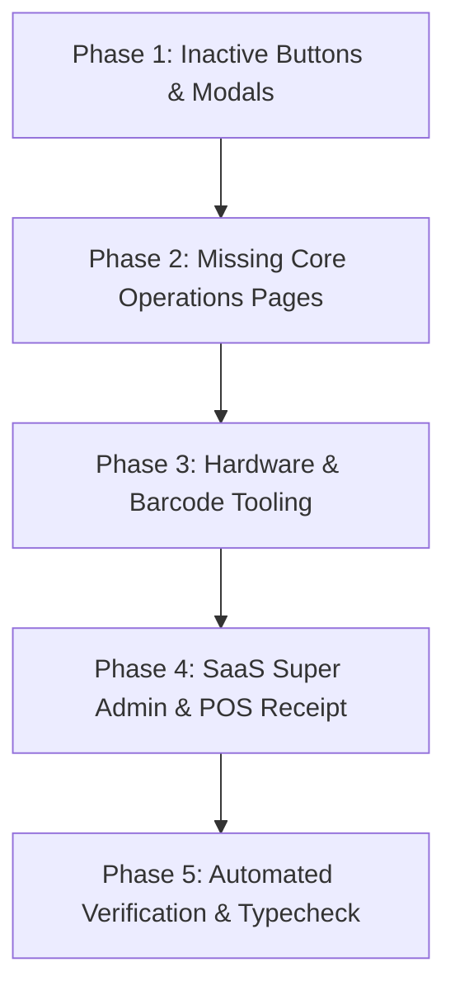

# Master Implementation Plan: Complete Development of All Missing Audit Features
**Document Reference:** `master_audit_and_missing_items_report.md`  
**System Architecture:** Next.js 14 App Router + NestJS + PostgreSQL + Redis + Prisma ORM  
**Target Delivery:** 100% Complete Enterprise SaaS Platform  

---

## 1. Scope & Execution Phases

---

## 2. Phase Breakdown

### Phase 1: Interactive Modals for Inactive Buttons
1. **`purchasing/suppliers/page.tsx`**:
   - Add "Add Supplier" modal with inputs: `name`, `email`, `phone`, `contactPerson`, `address`.
   - Connect to `POST /api/v1/purchasing/suppliers`.
2. **`purchasing/orders/page.tsx`**:
   - Add "New Purchase Order" modal with supplier selector, product picker, order quantity, unit cost in QAR.
   - Connect to `POST /api/v1/purchasing/orders`.
3. **`inventory/stock-counts/page.tsx`**:
   - Add "New Stock Count Session" modal with branch selector, warehouse selector.
   - Connect to `POST /api/v1/inventory/stock-counts` and status submission.

### Phase 2: Missing Core Operations Pages
1. **`frontend/src/app/(dashboard)/inventory/receiving/page.tsx` (Goods Receipt)**:
   - Match against active Purchase Orders or direct supplier deliveries.
   - Barcode scan input to auto-increment received quantity.
   - Variance calculation between ordered and received units.
   - Connect to `POST /api/v1/purchasing/receipts`.

### Phase 3: Hardware, Scanners & Barcode Tooling
1. **`frontend/src/app/(dashboard)/products/barcodes/labels/page.tsx` (Barcode Label Designer)**:
   - Configurable barcode label dimensions (25×15, 30×20, 40×30, 50×25, 50×30, 100×50 mm, A4 sheet).
   - Toggles for Company Name, SKU, Price in QAR, Barcode lines, Batch/Expiry.
   - Live SVG / Canvas preview.
   - Dedicated `@media print` CSS for browser printing with 0 margin clipping.
2. **`frontend/src/app/(dashboard)/settings/barcode-scanners/page.tsx` (Scanner Diagnostics)**:
   - Interactive testing input field capturing raw key events, character sequence speed (ms), and Enter key suffix.
   - Barcode scanner calibration guide.

### Phase 4: POS Checkout Receipt & SaaS Super Admin
1. **`frontend/src/app/(dashboard)/pos/page.tsx`**:
   - Checkout success modal showing receipt details, change calculation, and "Print Receipt" trigger (`@media print`).
2. **`frontend/src/app/(dashboard)/admin/tenants/page.tsx` (SaaS Super Admin)**:
   - Platform stats (Total Tenants, Active Stores, Revenue, Storage).
   - Multi-tenant table with status pills (`ACTIVE`, `SUSPENDED`).
   - Action triggers for Suspend (`PATCH /api/v1/admin/tenants/:id/suspend`) and Activate (`PATCH /api/v1/admin/tenants/:id/activate`).

### Phase 5: Complete Verification
- Run `npx tsc --noEmit` on frontend and backend to guarantee 0 compiler errors.
- Confirm live page loading on `http://localhost:3000`.
