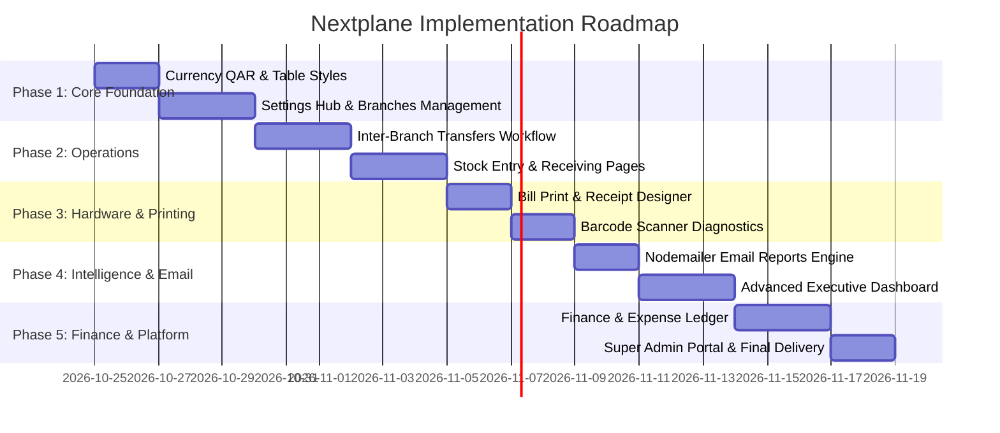

# NEXTPLANE: Master Implementation & Enhancement Plan
# Multi-Tenant Inventory SaaS, Multi-Branch POS & Enterprise Operations Platform

**Document Version:** 2.0  
**Currency Standard:** Qatari Riyal (`QAR`)  
**Target Environment:** Production-Ready Multi-Tenant Web Platform  
**Architecture:** Next.js 14 (App Router) + NestJS + PostgreSQL + Redis + Prisma ORM  

---

## 1. Executive Vision & Objectives

This document establishes the comprehensive architectural roadmap to elevate the existing Inventory SaaS into a high-performance, multi-branch enterprise platform designed for Qatar and Gulf retail/wholesale operations.

### Key Functional Pillars
1. **Multi-Branch Operations & Settings Management**: Direct branch creation, warehouse assignment, inter-branch stock matrices, and branch-filtered sales analytics.
2. **QAR Currency Standardization**: All pricing, ledgers, POS calculations, and financial reports default to `QAR` (Qatari Riyal).
3. **Enterprise Role-Based Access Control (RBAC)**: Fine-grained permission assignments, custom role creation, and view/action level authorization.
4. **Automated & On-Demand Email Reports (Nodemailer)**: Scheduled and manual delivery of daily executive summaries, low-stock warnings, and valuation reports.
5. **Modern Table Styling System**: High-density typography, hover highlights, sticky headers, multi-column sorting, and pagination.
6. **Inter-Branch Stock Transfer Engine**: Atomic transfer workflows (Request → Approval → Dispatch → In-Transit → Reception) with automated ledger tracking.
7. **Consolidated Settings & Hardware Hub**: Centralizing General, Branch Management, Integrations (API Keys & Webhooks), Barcode Scanners, and Bill Print Templates.
8. **Stock Entry & Goods Receipt**: Dedicated entry interfaces for opening stock, purchase receipts, and adjustment reasons.
9. **Executive Advanced Dashboard**: Multi-branch KPI filters, profit trends, top-selling items leaderboard, and low-stock telemetry.
10. **Finance & Basic Accounting Module**: Chart of accounts, income/expense vouchers, customer/supplier ledgers, and cash/bank balance registers.

---

## 2. Global Standards & Configurations

### 2.1 Currency & Localization (QAR Standard)
- **Currency Code:** `QAR`
- **Currency Symbol:** `QAR` / `ر.ق`
- **Formatting Standard:** `QAR 1,250.00` (two decimal places, thousand separators).
- **Default Locale:** `en-QA` with Arabic RTL (`ar-QA`) layout readiness.
- **Implementation:**
  - Update `frontend/src/lib/utils.ts` default: `formatCurrency(amount, currency = "QAR", locale = "en-QA")`.
  - Update backend seed and default tenant currency field: `currency: "QAR"`.

### 2.2 Reusable Table Design System (`DataTable`)
- **Container:** Rounded corners (`rounded-xl`), subtle borders (`border-slate-200 dark:border-slate-800`), glass card containers.
- **Header:** Sticky header with subdued slate background (`bg-slate-50/80 dark:bg-slate-900/80 backdrop-blur-sm`), uppercase muted labels (`text-xs font-semibold text-slate-500 uppercase tracking-wider`).
- **Rows:** Alternating subtle zebra striping or crisp border dividers, active row highlight on hover (`hover:bg-blue-50/40 dark:hover:bg-slate-800/40 transition-colors`).
- **Badges:** Semantically colored status pills (`Active`, `Draft`, `In Transit`, `Completed`, `Voided`).
- **Pagination Controls:** Rows per page selector (10, 25, 50, 100), total count indicators, disabled states for boundary limits.

---

## 3. Module Specifications

### Module A: Multi-Branch Infrastructure & Settings
#### Requirements
1. **Branch Management Hub (`/settings` -> Branches Tab)**:
   - Branch List table: Name, Code, Address, City, Phone, Email, Default Flag, Status.
   - "Add Branch" modal: Form with code auto-generation, city, phone, and optional warehouse creation.
   - Edit / Deactivate branch capabilities.
2. **Branch Warehouses**:
   - Each branch can have 1 or more warehouses (e.g. Main Showroom, Storage Basement).
   - Storage location tracking.
3. **Multi-Branch Stock Matrix (`/inventory/stock`)**:
   - Tabular view allowing store managers to see a single product's on-hand, reserved, and available stock broken down across every branch side-by-side.
4. **Branch-Wise Sales Filtering (`/sales`)**:
   - Branch selector in the header and sales table toolbar allowing managers to view transactions for "All Branches" or isolate a specific branch.

#### Database Entities
- `branches`: `id`, `tenantId`, `name`, `code`, `address`, `city`, `phone`, `email`, `isDefault`, `isActive`.
- `warehouses`: `id`, `tenantId`, `branchId`, `name`, `code`, `isDefault`, `isActive`.

---

### Module B: Enterprise Role-Based Access Control (RBAC)
#### Requirements
1. **Role Management Page (`/users` -> Roles Tab or `/settings/roles`)**:
   - Pre-seeded system roles: `Owner`, `Branch Manager`, `Inventory Manager`, `Cashier`, `Accountant`.
   - "Create Custom Role" button with title, description, and permission matrices grouped by modules:
     - Catalog (`products.read`, `products.create`, `products.update`, `products.delete`)
     - Inventory (`inventory.read`, `inventory.adjust`, `inventory.transfer`, `inventory.count`)
     - Sales / POS (`sales.read`, `sales.create`, `sales.void`, `sales.discount`)
     - Purchasing (`purchasing.read`, `purchasing.order`, `purchasing.receive`)
     - Financials (`finance.read`, `finance.vouchers`, `finance.ledger`)
     - Reports (`reports.sales`, `reports.inventory`, `reports.export`)
2. **User Role Assignment**:
   - When inviting or editing a team member, choose their assigned role and allowed branch access.

---

### Module C: Automated Email Reporting Engine (Nodemailer)
#### Requirements
1. **Backend Email Service (`MailService` in `backend/src/modules/mail`)**:
   - Nodemailer transport supporting SMTP (Host, Port, User, Password, From Address).
   - HTML template engine with responsive tables and KPI cards.
2. **Report Triggers**:
   - **Daily Executive Summary**: Automatically sent at midnight with total revenue (QAR), total orders, top selling items, and cash collected.
   - **Low Stock Urgent Digest**: Sent when critical SKUs breach reorder thresholds.
   - **On-Demand "Send via Email" Button**: Available on the `/reports` page allowing managers to email any generated report instantly to designated addresses.
3. **Settings UI (`/settings` -> Email Notifications)**:
   - Recipient email address list.
   - Toggle switches for Daily Summary, Low Stock Alerts, and Purchase Order approvals.
   - "Send Test Email" diagnostic button.

---

### Module D: Inter-Branch Stock Transfers
#### Requirements
1. **State Machine Workflow**:
   - `DRAFT`: Transfer drafted with items and quantities.
   - `APPROVED`: Source branch approves stock deduction.
   - `DISPATCHED` / `IN_TRANSIT`: Stock deducted from source warehouse balance and placed in transfer transit.
   - `RECEIVED`: Destination branch scans/verifies received quantities and stock is credited to destination warehouse atomically.
   - `REJECTED` / `CANCELLED`: Stock released back to source.
2. **User Interface (`/inventory/transfers`)**:
   - "New Transfer" modal: Select Source Branch & Warehouse, Destination Branch & Warehouse, Product Search/Scan with quantity picker.
   - Action buttons: "Dispatch", "Receive", "View Transfer Challan / PDF".

---

### Module E: Stock Entry & Goods Receiving
#### Requirements
1. **Stock Entry / Adjustments Page (`/inventory/entry` or `/inventory/adjustments`)**:
   - Dedicated interface to add opening stock, inventory reconciliations, or damaged stock write-offs.
   - Fields: Branch, Warehouse, Product / Barcode scan, Adjustment Type (`ADDITION`, `DEDUCTION`), Quantity, Unit Cost (QAR), Reason (`Opening Stock`, `Damaged`, `Supplier Bonus`, `Correction`).
2. **Goods Receiving (`/inventory/receiving`)**:
   - Match against an existing Purchase Order or direct receipt.
   - Scan barcode to auto-increment received quantity.
   - Instant calculation of variance between ordered and received quantities.

---

### Module F: Consolidated Settings & Hardware Hub
Re-architect `/settings` with dedicated tabs to avoid navigation scatter:
1. **General**: Company Name, CR Number, Tax ID, Currency (`QAR`), Timezone, Logo upload.
2. **Branches**: Manage branch locations, contact numbers, and default warehouses.
3. **Bill / Receipt Designer**:
   - Manage print models (Thermal 80mm POS receipt vs A4 Corporate Invoice).
   - Customize Header, Logo, Phone, Address, Terms & Conditions footer, and QR Code (ZATCA/Qatari e-invoice format).
   - Live browser preview with `@media print` layout.
4. **Barcode Scanners**:
   - Interactive testing bench: Type or scan to test scan speed, enter-key suffix detection, and product resolution.
   - Workstation troubleshooting guide.
5. **Developer & Integrations**:
   - Consolidated API Keys management (Create, Revoke, Copy Key).
   - Webhook subscriptions (Endpoint URL, Event picker, HMAC signing secret).
6. **Notifications & Email**:
   - SMTP configuration and report recipient lists.

---

### Module G: Executive Advanced Dashboard
#### Requirements
1. **Branch Context Switcher**: Top banner selector allowing analytics view for "All Stores" or filtered to a single location.
2. **Financial KPI Ribbon (in QAR)**:
   - Today's Revenue (`QAR X,XXX.XX`) with % comparison to yesterday.
   - Monthly Cumulative Revenue (`QAR XX,XXX.XX`).
   - Net Profit Estimate (`Revenue - Cost of Goods Sold`).
   - Low Stock Alert Count with instant modal trigger.
3. **Sales vs. Purchases Trend Chart**: Interactive dual-area graph showing sales income vs purchase expenses over the last 14/30 days.
4. **Top 5 Selling Items Leaderboard**: Ranked table showing product name, SKU, units sold, and revenue generated.
5. **Real-Time Recent Activity Feed**: Live ledger of recent POS checkouts, stock transfers, and PO receipts.

---

### Module H: Basic Accounting & Finance Module
#### Requirements
1. **Database Schema Additions**:
   - `accounts`: Chart of accounts (`ASSET`, `LIABILITY`, `EQUITY`, `REVENUE`, `EXPENSE`).
   - `journal_entries`: Reference, date, description, tenantId, branchId.
   - `journal_entry_lines`: Account ID, Debit amount (QAR), Credit amount (QAR).
   - `expense_vouchers`: Category, Payee, Amount (QAR), Payment Method, Receipt attachment.
2. **Finance UI Routes**:
   - `/finance/overview`: Quick profit & loss estimate, cash in hand, bank balance.
   - `/finance/expenses`: Create and log store operational expenses (Rent, Electricity, Salaries, Packaging).
   - `/finance/ledger`: View customer and supplier outstanding balances.

---

## 4. Phase-by-Phase Implementation Roadmap

### Phase 1: Foundation, QAR Currency & Branches Hub
- [ ] **Step 1.1**: Update `formatCurrency` in `frontend/src/lib/utils.ts` to default to `QAR` (`en-QA`).
- [ ] **Step 1.2**: Polish `DataTable` component (`frontend/src/components/shared/data-table.tsx`) with modern padding, row hover animations, and sticky headers.
- [ ] **Step 1.3**: Restructure `frontend/src/app/(dashboard)/settings/page.tsx` with unified tabs: `General`, `Branches`, `Bill Templates`, `Scanners`, `Integrations`, `Email Reports`.
- [ ] **Step 1.4**: Implement Branch creation and editing in Settings, connecting to `POST /api/v1/branches` and `PATCH /api/v1/branches/:id`.

### Phase 2: Stock Operations & Inter-Branch Transfers
- [ ] **Step 2.1**: Implement Inter-Branch Stock Transfer creation modal in `frontend/src/app/(dashboard)/inventory/transfers/page.tsx`.
- [ ] **Step 2.2**: Connect backend status transitions for transfers (`APPROVED`, `DISPATCHED`, `RECEIVED`).
- [ ] **Step 2.3**: Build `/inventory/entry` for opening stock entry and adjustments with atomic ledger posting.
- [ ] **Step 2.4**: Build `/inventory/receiving` to scan and receive Goods Receipts against purchase orders.
- [ ] **Step 2.5**: Upgrade `/inventory/stock` (Stock Finder) to display multi-branch stock columns side-by-side.

### Phase 3: Bill / Receipt Printing & Hardware Integration
- [ ] **Step 3.1**: Build Receipt / Bill Print Template Manager in Settings (support 80mm thermal and A4).
- [ ] **Step 3.2**: Add automatic Receipt Preview & Print Modal in `/pos` upon successful sale completion.
- [ ] **Step 3.3**: Create `/settings/barcode-scanners` (Scanner diagnostics bench with latency measurement and test field).
- [ ] **Step 3.4**: Create `/products/barcodes/labels` (Visual Barcode Label Designer with preset mm sizes and print preview).

### Phase 4: Email Reporting & Advanced Dashboard
- [ ] **Step 4.1**: Create `backend/src/modules/mail` using Nodemailer and configure SMTP environment credentials.
- [ ] **Step 4.2**: Implement backend endpoints to generate and email daily sales reports and low-stock alerts.
- [ ] **Step 4.3**: Add "Send Email Report" modal and schedule controls on `frontend/src/app/(dashboard)/reports/page.tsx`.
- [ ] **Step 4.4**: Upgrade `frontend/src/app/(dashboard)/dashboard/page.tsx` into an Executive Dashboard featuring multi-branch filter, QAR profit calculations, dual area charts, and top products leaderboard.

### Phase 5: Finance / Accounts & SaaS Super Admin
- [ ] **Step 5.1**: Add Expense and Cash/Bank voucher models to `backend/prisma/schema.prisma`.
- [ ] **Step 5.2**: Create `frontend/src/app/(dashboard)/finance` for operational expenses and P&L estimation.
- [ ] **Step 5.3**: Build `/admin/tenants` for SaaS Super Admins to manage and suspend/activate tenant subscriptions.
- [ ] **Step 5.4**: Run automated validation, linting, and end-to-end integration verification.

---

## 5. Verification & Acceptance Criteria
1. **Currency Accuracy**: Every displayed monetary figure uses `QAR` without any hardcoded USD signs.
2. **Branch Isolation & Aggregation**: Filtering by branch updates stock tables and sales histories without cross-tenant or cross-branch data corruption.
3. **Atomic Transfers**: Moving 10 items from Branch A to Branch B decreases Branch A's on-hand count and increases Branch B's on-hand count only upon committed receipt.
4. **Scannability**: Barcode labels generated through `/products/barcodes/labels` must physically scan on standard 1D/2D optical readers.
5. **Print Layouts**: Receipts printed on 80mm thermal printers render with zero page clipping and no browser header/footer artifacts.
