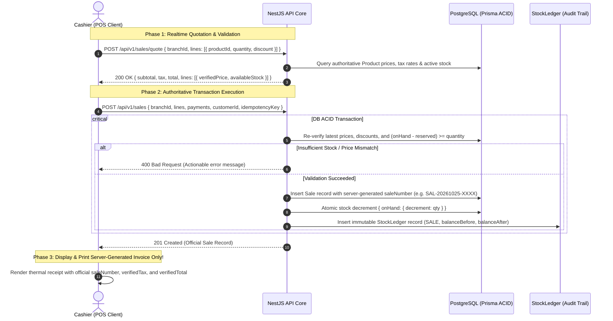

# Comprehensive Implementation Plan: Server-Authoritative Calculations & Zero-Trust Architecture
**Target System:** Inventory_SaaS (NestJS + PostgreSQL Prisma + Next.js App Router)  
**Currency Standard:** QAR (Qatari Riyal)  
**Precision Model:** 2-Decimal Rounded Arithmetic (`Math.round(x * 100) / 100`)  
**Architecture Policy:** Zero-Trust Client (Client submits intent only; Backend is sole authority for all pricing, stock, tax, refunds, and invoice numbering)

---

## 1. Executive Summary & Audit Baseline

In an enterprise SaaS multi-tenant environment, the client (browser/POS) must **never** be trusted for calculations or transaction integrity. The client's role is strictly limited to:
1. Providing an intuitive user interface.
2. Collecting user intent (e.g. `productId`, `quantity`, `branchId`).
3. Rendering official, immutable transaction artifacts generated by the backend server.

### Critical Vulnerabilities & Remediation Summary

| Area / File | Identified Vulnerability / Gap | Severity | Authoritative Solution |
| :--- | :--- | :--- | :--- |
| **Sales Returns**<br>`backend/.../sales.service.ts` | `createReturn` accepted `unitPrice` and `quantity` from client DTO without checking original sale lines, allowing fraudulent refund pricing or returning more items than sold. Non-atomic stock updates. | **CRITICAL** | Match return items against original `sale.lines`. Enforce sold `unitPrice` and cap maximum returnable quantity (`soldQty - alreadyReturnedQty`). Atomic stock increment + Ledger. |
| **POS Checkout & Receipts**<br>`frontend/.../pos/page.tsx` | 1. Client generated fake `REC-2026-XXXXX` receipt numbers.<br>2. Client computed subtotal and sent `payments: [{ amount: subtotal }]`, ignoring backend VAT calculations. | **CRITICAL** | 1. Add `POST /sales/quote` endpoint for instant server-verified cart pricing, taxes, and stock availability.<br>2. Eliminate fake client numbers. Print strictly the official backend `saleNumber` and verified financial breakdown. |
| **Purchasing & PO**<br>`backend/.../purchasing.service.ts` | 1. `createPurchaseOrder` accepted client line totals without DB cost cross-check.<br>2. `receiveGoods` set stock with non-atomic updates and didn't prevent over-receiving against PO quantities. | **HIGH** | 1. Compute PO totals server-side with strict 2-decimal rounding (`round2`).<br>2. Atomically increment stock (`{ onHand: { increment: qty } }`) and validate received quantity against PO limit. |
| **Stock Transfers**<br>`backend/.../inventory.service.ts` | When transfer was `APPROVED` or `IN_TRANSIT`, stock in the source branch was not reserved. Items could be sold while in transit, causing negative balances on receipt. | **HIGH** | Call `reserveStock` when transfer is `APPROVED`/`IN_TRANSIT`. On `RECEIVED`, atomically deduct onHand + reserved on source and increment destination. On `CANCELLED`, release held stock. |

---

## 2. Zero-Trust Data Flow Architecture



---

## 3. Step-by-Step Implementation Tasks

### Phase 1: Backend Authoritative Core Hardening

#### Task 1.1: Sales Returns & Refunds Strict Validation
- **File:** `backend/src/modules/sales/sales.service.ts`
- **Actions:**
  1. In `createReturn(tenantId, userId, dto)`:
     - Load original sale including `lines` and all existing `returns.lines`.
     - Build a lookup map of original sale lines: `Map<productId, { originalQty, unitPrice, discount, tax, alreadyReturnedQty }>`.
     - Reject return if any returned product was not part of the original sale.
     - Reject return if `returnQty > (originalQty - alreadyReturnedQty)`.
     - Override any client-provided `unitPrice` with the **exact net sold price** (`(originalLine.total / originalLine.quantity)`).
     - Calculate `totalReturnAmount` server-side using 2-decimal rounded precision:
       $$\text{totalReturnAmount} = \sum \text{round2}(\text{returnQty} \times \text{actualSoldUnitPrice})$$
     - Atomically increment `stockBalance.onHand` via `{ onHand: { increment: returnQty } }`.
     - Create immutable `StockLedger` entry with `transactionType: 'RETURN'`.

#### Task 1.2: Purchasing Order Calculation & Atomic Goods Receipt
- **File:** `backend/src/modules/purchasing/purchasing.service.ts`
- **Actions:**
  1. In `createPurchaseOrder`:
     - Load products from DB for all line items.
     - Fall back to product `costPrice` if unitPrice is omitted or invalid.
     - Compute line totals and order total with strict 2-decimal precision.
  2. In `receiveGoods`:
     - Load PO and existing goods receipts to verify remaining receivable quantity per line.
     - Prevent over-receiving: `receivedQty + previouslyReceivedQty <= poLineQty`.
     - Perform atomic increment in `stockBalance`:
       ```typescript
       await tx.stockBalance.upsert({
         where: { tenantId_branchId_productId_warehouseId: ... },
         update: { onHand: { increment: line.quantity } },
         create: { tenantId, branchId, productId, warehouseId, onHand: line.quantity, reserved: 0 }
       });
       ```
     - Write `StockLedger` entry with `transactionType: 'PURCHASE_RECEIPT'`.

#### Task 1.3: Stock Transfer Inventory Reservation Lifecycle
- **File:** `backend/src/modules/inventory/inventory.service.ts`
- **Actions:**
  1. In `updateTransferStatus`:
     - When transitioning to `APPROVED` or `IN_TRANSIT`:
       - Loop through transfer lines in a transaction.
       - Check `available = onHand - reserved`. If `available < requestedQuantity`, throw `BadRequestException('Insufficient available stock to approve transfer')`.
       - Atomically increment `reserved` by `requestedQuantity` on source branch: `{ reserved: { increment: requestedQuantity } }`.
       - Create `StockLedger` entry: `RESERVE_STOCK`.
     - When transitioning to `RECEIVED`:
       - On source branch: atomically deduct `onHand` and deduct `reserved`: `{ onHand: { decrement: qty }, reserved: { decrement: qty } }`.
       - On destination branch: atomically increment `onHand`: `{ onHand: { increment: qty } }`.
       - Create dual ledger entries: `TRANSFER_OUT` (source) and `TRANSFER_IN` (destination).
     - When transitioning to `CANCELLED` (from `APPROVED` or `IN_TRANSIT`):
       - Atomically release reservation on source: `{ reserved: { decrement: qty } }`.
       - Create `StockLedger` entry: `RELEASE_STOCK`.

#### Task 1.4: Realtime Quote & Cart Validation Endpoint (`POST /sales/quote`)
- **Files:**
  - `backend/src/modules/sales/sales.controller.ts`
  - `backend/src/modules/sales/sales.service.ts`
  - `backend/src/modules/sales/dto/quote-sale.dto.ts`
- **Actions:**
  1. Create `QuoteSaleDto`: `{ branchId: string; lines: [{ productId: string; productVariantId?: string; quantity: number; discount?: number }] }`.
  2. Create `getSaleQuote(tenantId, dto)`:
     - Runs fast read-only price and tax computation with DB product records.
     - Returns:
       ```json
       {
         "subtotal": 150.00,
         "tax": 0.00,
         "total": 150.00,
         "currency": "QAR",
         "lines": [
           {
             "productId": "...",
             "productName": "Apple iPad Pro",
             "unitPrice": 150.00,
             "quantity": 1,
             "discount": 0.00,
             "tax": 0.00,
             "total": 150.00,
             "availableStock": 24,
             "isStockSufficient": true
           }
         ],
         "isValid": true
       }
       ```

---

### Phase 2: Frontend Thin-Client Integration

#### Task 2.1: POS Terminal Checkout Hardening (`frontend/src/app/(dashboard)/pos/page.tsx`)
- **Actions:**
  1. Remove fake `REC-2026-XXXXX` receipt number generation.
  2. When checkout succeeds, extract the authoritative response from backend:
     ```typescript
     const res = await api.post('/sales', payload);
     const officialSale = (res.data as any)?.data ?? res.data;
     setCompletedSale({
       receiptNo: officialSale.saleNumber, // Official DB saleNumber
       items: officialSale.lines,
       subtotal: officialSale.subtotal,
       tax: officialSale.tax,
       total: officialSale.total,
       amountTendered: ...,
       change: ...,
       date: new Date(officialSale.createdAt).toLocaleString(),
       customerName: officialSale.customer?.name || 'Walk-in Retail Shopper',
       branchName: officialSale.branch?.name || 'Main Retail Branch'
     });
     ```
  3. Integrate realtime server quote on cart changes or before opening payment modal.

#### Task 2.2: Sales Return & Refund UI Alignment (`frontend/src/app/(dashboard)/sales/page.tsx`)
- **Actions:**
  1. Ensure return modal displays original sold price and remaining returnable quantity.
  2. Disable editing unit price in client UI; client sends `{ saleId, lines: [{ productId, quantity }] }`.

#### Task 2.3: Purchasing & Transfers Frontend Refinement
- **Actions:**
  1. `orders/page.tsx`: Display server-computed totals and live status badges (`DRAFT`, `APPROVED`, `RECEIVED`).
  2. `transfers/page.tsx`: Clearly display `Reserved In-Transit` indicator on source branch.

---

## 4. Verification & Testing Matrix

| Test Case | Description | Expected Outcome |
| :--- | :--- | :--- |
| **T1: Price Tampering Test** | Client sends a request to `/sales` with `unitPrice: 1.00 QAR` for an item that costs `100.00 QAR`. | Backend overrides or rejects client price; charges exact DB price `100.00 QAR`. |
| **T2: Refund Fraud Test** | Client attempts to return item at `500.00 QAR` when sold at `100.00 QAR`, or attempts to return `5` items when only `2` were sold. | Backend throws `400 Bad Request` with exact quantity / price limit violation. |
| **T3: Transfer Stock Race Test** | 10 units exist. Transfer of 10 units is `APPROVED`. Cashier tries to sell 1 unit from source branch before transfer is received. | POS sale rejected with `Insufficient available stock (10 on hand, 10 reserved)`. |
| **T4: Over-Receipt Test** | PO is for 50 units. Supplier delivers 60 units. Warehouse attempts to receive 60 units. | Backend limits or rejects excess goods receipt beyond approved PO quota. |
| **T5: Floating-Point Rounding Test** | Items with fractional prices (e.g., 3 items at 33.33 QAR each with 5% VAT). | All line items and grand totals round to exact 2-decimal QAR without JS precision artifacts. |

---

## 5. Execution Order

```
[Phase 1.1: Sales Returns Core] ──> [Phase 1.2: Purchasing & Receipt Core] ──> [Phase 1.3: Stock Transfer Reservations]
                                                                                        │
[Phase 2.1: POS Server Invoice] <── [Phase 1.4: Realtime Server Quote API] <───────────┘
         │
[Phase 2.2: Returns & Transfer UI]
         │
[Phase 3: Automated Verification Scripts (T1 - T5)]
```
